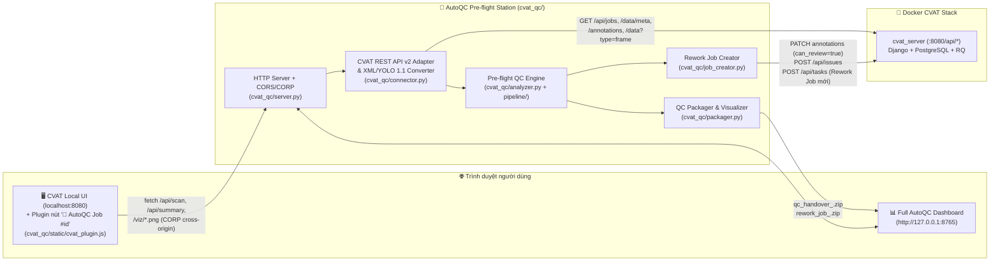

# Báo Cáo Kỹ Thuật & Kịch Bản Demo: CVAT Local AutoQC Pre-flight Station

**Học viên:** La Thái Hòa — **MSHV:** `2A202603069`  
**Dự án:** `K5-L23-Day09-LaThaiHoa-2A202603069-AutoQC-Pipeline-Lab`  
**Tính năng:** Trạm Kiểm Soát Nhanh AutoQC Tích Hợp Trực Tiếp Vào CVAT Local (`http://localhost:8080` + `http://127.0.0.1:8765`)

---

## 0. Giải Thích Dễ Hiểu Cho Mọi Người (Trong 60 Giây)

Hãy tưởng tượng dây chuyền gán nhãn ảnh giống như **một xưởng sản xuất**: mỗi người gán nhãn vẽ xong hàng trăm ảnh (1 Job) rồi gửi bộ phận kiểm định (QC) chấm lại. Nếu không có bộ lọc trung gian, người QC phải mở thủ công từng tấm ảnh để dò lỗi — rất chậm và dễ sót.

**Tính năng này là "Trạm Kiểm Soát Nhanh Tự Động" gắn ngay bên trong CVAT:**
1. **🔍 Quét & Chấm Điểm Tự Động:** Bấm 1 nút ngay trong CVAT, máy tự kiểm tra toàn bộ ảnh, tự sửa ngay các lỗi máy móc an toàn (xóa box trùng đè, cắt box tràn viền...) và chấm điểm chất lượng Job (vd. `61.7/100`), kết luận **RELEASE** / **HOLD** / **REWORK**.
2. **🎯 Tạo Task Sửa Lỗi Theo Từng Loại Issue:** Thay vì gom chung tất cả lỗi vào một chỗ, quản lý có thể chọn **tạo riêng từng Task cho từng loại lỗi** (vd: Task chỉ gồm các ảnh nghi gán nhầm loại xe `POSSIBLE_WRONG_CLASS`, Task chỉ gồm các ảnh bị sót nhãn `POSSIBLE_MISSING`) và gắn sẵn cờ `can_review=true` để chia người sửa song song.
3. **📜 Ghi Lại Lịch Sử Chỉnh Sửa Rework (Trước ↔ Sau):** Khi người sửa lưu lại bài trên CVAT, trạm tự đối chiếu bản **Trước khi sửa** và **Sau khi sửa** để ghi nhật ký chi tiết tới từng hộp: *Đã đổi lớp `truck → bus`*, *Đã thêm box mới*, *Đã kéo chỉnh khung*, hay *Đã xóa box thừa*. Nhờ đó QC biết chính xác Job đã được sửa những gì qua từng vòng.
4. **📦 Đóng Gói Bàn Giao 1 Cú Click:** Xuất gói `.zip` tự chứa báo cáo web, CSV, ảnh đối chiếu AI và lịch sử chỉnh sửa Rework gửi cho bộ phận QC.

---

## 1. Động Lực & Bài Toán Nghiệp Vụ

Trong quy trình gán nhãn Computer Vision trên **CVAT Local**, khi Annotator hoàn thành một CVAT Job, bộ phận QC thường phải mở thủ công từ frame đầu đến frame cuối để rà soát lỗi. Quy trình này gặp 4 nút thắt:
1. **Lãng phí thời gian cho lỗi quy tắc:** Ảnh hỏng/trùng, box tràn ảnh, box trùng lặp (`DUP_BOX`), box siêu nhỏ (`BOX_TINY`) lẽ ra máy phát hiện và sửa được trong vài giây.
2. **Duyệt tuần tự không ưu tiên:** Frame sạch và frame sai nặng nằm lẫn lộn, không biết nên mở ảnh nào trước khi ngân sách thời gian có hạn.
3. **Thiếu đối chiếu ngữ nghĩa tức thì:** Người duyệt không có sẵn box gợi ý từ model lớn (`yolo26l`) đặt cạnh nhãn hiện tại để nhanh chóng nhận ra ca thiếu nhãn hay nhầm lớp.
4. **Thiếu công cụ tách Rework Job & đóng gói bàn giao:** Khó tạo nhanh một Job sửa lỗi riêng có đánh dấu sẵn `can_review=true` và gói hồ sơ đầy đủ gửi cho bộ phận QC.

**`CVAT Local AutoQC Pre-flight Station`** giải quyết bài toán trên bằng cách tích hợp trực tiếp lõi Pipeline Day 09 vào **CVAT Local** như một trạm kiểm soát trước khi con người kiểm tra.

---

## 2. Kiến Trúc Tích Hợp Hai Chiều Với CVAT Local

### Điểm nhấn kỹ thuật khi tích hợp vào CVAT Docker
- **Nhúng UI trực tiếp vào `cvat_ui`:** [scripts/install_cvat_plugin.py](../scripts/install_cvat_plugin.py) cài đặt [cvat_qc/static/cvat_plugin.js](../cvat_qc/static/cvat_plugin.js) vào `/usr/share/nginx/html/assets/autoqc-plugin.js` của container `cvat_ui` và tự động theo dõi URL `/tasks/{tid}/jobs/{jid}`.
- **Tương thích COEP/CORS của Nginx CVAT:** `cvat_ui` bật `Cross-Origin-Embedder-Policy: credentialless`, nên [cvat_qc/server.py](../cvat_qc/server.py) cấp header `Access-Control-Allow-Origin: *` và `Cross-Origin-Resource-Policy: cross-origin` trên mọi API và ảnh `/viz/*.png`.
- **Chuẩn giao tiếp CVAT REST API v2:** Dùng header `Accept: application/vnd.cvat+json, application/json, */*` và tự động lấy API Token qua `resolve_cvat_token()`.

---

## 3. Phân Tích Kỹ Thuật Các Thành Phần Code

1. **`cvat_qc/connector.py`**:
   - `pull_job_live`: Kéo frame ảnh, labels, shapes của một CVAT Job bất kỳ, chuẩn hóa sang YOLO và lưu bảng ánh xạ `(stem, line_no) ↔ shape_id, frame, points, can_review_spec_id` trong `live_mapping.json`.
   - `apply_flags_to_cvat_job`: Gửi `PATCH /api/jobs/{id}/annotations?action=update` để bật `can_review="true"` đúng lên các box nghi vấn và gọi `POST /api/issues` tạo CVAT Issue kèm chống trùng lặp.
   - `create_rework_task_live`: Tạo Task mới trên CVAT (`POST /api/tasks`), upload ảnh (`POST /api/tasks/{id}/data`), chờ RQ worker tạo Job, đẩy nhãn đã `autofix` và gắn `can_review=true` qua `PUT /api/jobs/{id}/annotations` và tạo Issues.
   - `export_yolo11_zip` / `import_yolo11_zip` (kèm chống Zip Slip) & `export_cvat_xml` (chuẩn CVAT 1.1 XML).
2. **`cvat_qc/analyzer.py`**:
   - Chạy `intake` + 5 QC checks + `autofix` + `review_queue` + `gate` của Lab Day 09.
   - Tự động ánh xạ tên lớp nếu Job trên CVAT có bộ nhãn mở rộng (vd. Job Day 08) và sử dụng `data/cache/checker_preds.json` hoặc model cục bộ (`_resolve_predictions`).
   - Tính **Quality Score**: `max(0, 100 - ((1.5 * n_err_imgs + 0.5 * n_warn_only_imgs) / n_scanned) * 100)`.
3. **`cvat_qc/job_creator.py`**:
   - Lọc ảnh lỗi chung hoặc **theo từng loại Issue (`issue_codes`)**; hỗ trợ `create_rework_jobs_by_issue` tự tách mỗi mã lỗi thành 1 Task độc lập.
   - Đóng gói `rework_job_<job_id>.zip` (chuẩn YOLO 1.1 + CVAT XML + `rework_manifest.json`), lưu snapshot baseline và đẩy lên CVAT Local.
4. **`cvat_qc/rework_history.py`**:
   - `save_baseline_snapshot`: Lưu trạng thái gốc trước khi chỉnh sửa.
   - `compute_rework_diff` & `record_rework_history`: Ghép cặp từng hộp trước ↔ sau theo IoU (`>= 0.30`), phân loại `CLASS_CHANGED`, `BOX_ADJUSTED`, `BOX_ADDED`, `BOX_DELETED` và lưu lũy kế vào `rework_history.json` / `rework_history.csv`.
5. **`cvat_qc/packager.py`**:
   - `render_single_viz`: Vẽ hộp Annotator (nét liền + `[!MÃ_LỖI]`) và hộp gợi ý AI `yolo26l` (nét đứt màu vàng).
   - Tạo `qc_report.html` (chống XSS), `qc_report.md`, gom báo cáo CSV + `rework_history.*` và nén thành `qc_handover_<job_id>.zip`.
6. **`cvat_qc/server.py` & `scripts/cvat_autoqc.py`**:
   - Web Server cục bộ cổng `8765` hỗ trợ danh sách CVAT Jobs, `/api/scan`, `/viz/<stem>.png`, `/api/cvat/flag`, `/api/cvat/create-rework` (hỗ trợ `issue_codes` và `split_by_code`), `/api/rework-history`, `/api/cvat/track-rework`, và tải ZIP/CSV.

---

## 3.5. Bảng Giải Thích Chi Tiết Từng Chức Năng & Các Thuộc Tính Liên Quan

### A. Bảng Chức Năng Nghiệp Vụ & Luồng Thực Thi (UI / API / CLI)

| # | Chức năng trên Feature | Nút UI / Endpoint / Lệnh CLI | Hàm xử lý chính | Thuộc tính & Tham số đầu vào / đầu ra liên quan |
|---|---|---|---|---|
| **1** | **Nhúng Plugin & Nhận diện Job tự động trong CVAT UI** | Nút nổi `#autoqc-fab` (`🚦 AutoQC Job #<id>`) trong `localhost:8080` | `detectJobFromUrl()`, `install_ui_plugin()` | • `window.location.pathname` khớp mẫu `/tasks/(\d+)/jobs/(\d+)` để trích `taskId`, `jobId`. • `PLUGIN_TAG`: `/assets/autoqc-plugin.js?v=2` cài vào `cvat_ui:/usr/share/nginx/html/assets/`. • Tương thích `COEP: credentialless` nhờ header `Cross-Origin-Resource-Policy: cross-origin` và `Access-Control-Allow-Origin: *`. |
| **2** | **Liệt kê & Chọn nguồn Job cần kiểm tra** | Dropdown `#jobSelect` / `#aq-job-sel` `GET /api/jobs` | `CVATLocalClient.list_jobs()`, `resolve_cvat_token()` | • Đầu vào: `base_url` (`http://localhost:8080`), `token` (tự lấy từ `CVAT_TOKEN` hoặc `cvat_server`), `page_size=100`. • Thuộc tính trả về mỗi Job: `id`, `task_id`, `task_name`, `project_id`, `project_name`, `stage`, `state`, `frame_count`, `assignee`, `url`. • Hỗ trợ thêm nguồn cục bộ (`mode: "local"`, `src: "data/raw"`, hoặc file `.zip` YOLO 1.1). |
| **3** | **Kéo dữ liệu Live từ CVAT Job & Ánh xạ nhãn** | `POST /api/scan` (`mode: "cvat"`) `--job-id <id> --cvat-url ...` | `CVATLocalClient.pull_job_live()`, `prepare_source_dataset()` | • Kéo đồng bộ từ 4 API CVAT: `/api/jobs/{id}`, `/api/jobs/{id}/data/meta`, `/api/jobs/{id}/annotations`, `/api/labels?job_id={id}` và tải từng frame qua `/api/jobs/{id}/data?type=frame&quality=compressed&number={frame}`. • Tạo `live_mapping.json` lưu 2 bảng ánh xạ: `frames_by_stem[stem]` (`frame`, `name`, `width`, `height`) và `shapes_by_line["stem:line"]` (`id`, `label_id`, `label_name`, `can_review_spec_id`, `frame`, `points`, `attributes`). |
| **4** | **Quét lỗi tự động (Pre-flight QC) & Chấm điểm Job** | Nút **`🔍 Quét lỗi`** `POST /api/scan`, `POST /api/rerun` | `analyze_cvat_job()`, `_resolve_predictions()`, `_map_flagged_lines()` | • Tham số điều khiển: `apply_autofix=True`, `use_second_opinion=True`, `cfg` (`configs/pipeline.yaml`: `duplicates.phash_dist=10`, `second_opinion.conf=0.6`, `label_format.min_box_px=12`, `gate.warn_ratio_hold=0.10`). • Ngầm bỏ qua `intake.reference_dirs` nếu Job live không thuộc dự án Day 09. • Đầu ra `JobQCResult`: `quality_score` (0–100), `verdict`, `intake_issues`, `v1_issues`, `fixes`, `v2_issues`, `review_queue`, `flagged_lines`, `model_suggestions`, `class_counts`, `elapsed_sec`. |
| **5** | **Tự động sửa lỗi cú pháp an toàn (`Autofix`)** | Chạy tự động trong `analyze_cvat_job` | `pipeline.steps.autofix.fix()` | • Chỉ xử lý `severity == "error"`, giữ nguyên `data/raw` và file nguồn (chỉ sửa trên `work_dir/clean_ds`). • Thuộc tính mỗi dòng fix (`03_fixes.csv`): `image`, `line`, `action` (`remove_image`, `rename_classes`, `drop_line`, `clip_box`, `needs_label`), `before`, `after`. |
| **6** | **Xếp hàng đợi ưu tiên & Quyết định Cổng (`Gate`)** | Bảng hàng đợi trong UI `GET /api/summary` | `review_queue.build_queue()`, `gate.decide()` | • Thuộc tính mỗi dòng hàng đợi: `image`, `priority` (tổng trọng số từ `cfg["review"]["weights"]`), `codes`, `frame`, `cvat_frame_url`. • Thuộc tính `verdict`: `decision` (`Release` / `Hold` / `Rework`), `n_errors`, `n_warn_images`, `n_images`, `warn_ratio`, `reasons`. |
| **7** | **Soi lỗi trực quan theo từng Frame & Nhảy thẳng tới CVAT** | Bấm dòng bảng / nút **`Soi`** / link **`Frame <n>`** `GET /api/frame-detail`, `GET /viz/<stem>.png` | `render_single_viz()`, `build_html_report()` | • Render PNG theo yêu cầu cho mọi ảnh: khung **nét liền** (nhãn Annotator kèm mã lỗi `[!CODE]`), khung **nét đứt màu vàng** `#facc15` (gợi ý AI `yolo26l` kèm `conf`). • Trả về `issues` (`severity`, `code`, `line`, `message`), `suggestions` (`code`, `class_id`, `class_name`, `conf`, `box`), và `cvat_frame_url` (`/tasks/{tid}/jobs/{jid}?frame={frame}`). |
| **8** | **Gắn cờ `can_review=true` & Tạo Issue trực tiếp trên CVAT** | Nút **`🏷️ Gắn can_review & Tạo Issue`** `POST /api/cvat/flag` hoặc `--flag-cvat` | `CVATLocalClient.apply_flags_to_cvat_job()`, `create_issue()` | • Cập nhật thuộc tính `can_review` (`spec_id` trên shape) thành `"true"` qua `PATCH /api/jobs/{id}/annotations?action=update`. • Tạo CVAT Issue qua `POST /api/issues` với `{job, frame, position: [xtl, ytl, xbr, ybr], message}` (tự chống tạo trùng Issue đã tồn tại). • Hỗ trợ lọc ngay trong CVAT Filters: `attr["can_review"] == true`, `width < 20`. |
| **9** | **Tạo Rework Sub-Job (Chung hoặc Tách theo từng loại Issue)** | Dropdown `#reworkIssueFilter` / `#aq-rework-issue-sel` + **`➕ Tạo Rework Job`** `POST /api/cvat/create-rework` `--rework-issues`, `--split-rework-by-issue` | `create_rework_job()`, `create_rework_jobs_by_issue()`, `_select_rework_stems()`, `create_rework_task_live()` | • Tham số: `max_images`, `project_id`, `live_push`, `issue_codes`, `split_by_code`. • Chỉ giữ ảnh & cờ `can_review=true` khớp loại Issue; tự lưu baseline vào `baselines/cvat_<new_job_id>`. |
| **10** | **Ghi nhận & Đối chiếu Lịch sử Chỉnh sửa Rework** | Nút **`🔄 Đồng bộ & Ghi Lịch Sử Sửa`** / **`🔄 Ghi Lịch Sử Sửa`** `GET /api/rework-history` `POST /api/cvat/track-rework` `GET /download/rework-history` | `save_baseline_snapshot()`, `compute_rework_diff()`, `record_rework_history()`, `load_rework_history()` | • Kéo nhãn mới nhất từ CVAT, ghép cặp box trước ↔ sau bằng IoU (`>= 0.30`), phân loại `CLASS_CHANGED`, `BOX_ADJUSTED`, `BOX_ADDED`, `BOX_DELETED`. • Ghi lũy kế theo phiên vào `rework_history.json` & `rework_history.csv`. |
| **11** | **Đóng gói hồ sơ lỗi gửi Bộ phận QC** | Nút **`📦 Tải QC Handover (.zip)`** `GET /download/handover` | `build_qc_bundle()`, `build_markdown_report()`, `build_html_report()` | • Tham số: `top_viz`. • Đầu ra `qc_handover_<job_id>.zip` chứa: `qc_report.html`, `qc_report.md`, `reports/*`, `viz/*.png`, `rework_job_<id>.zip`, `cvat_annotations_can_review.xml`, `cvat_labels.json`, `rework_history.*`. |

---

### B. Bảng Các Thuộc Tính Dữ Liệu Cốt Lõi Trong Hệ Thống

| Đối tượng / Tệp | Tên thuộc tính | Kiểu dữ liệu | Ý nghĩa & Vai trò |
|---|---|---|---|
| **`JobQCResult`** (`analyzer.py`) | `job_id`, `annotator`, `timestamp` | `str` | Định danh Job đang quét, người gán nhãn và dấu thời gian thực hiện. |
| | `n_scanned`, `n_accepted`, `n_rejected` | `int` | Tổng số ảnh đầu vào, số ảnh qua cửa vào (`intake`), số ảnh bị loại (hỏng/nhỏ/trùng/rò rỉ). |
| | `quality_score` | `float` (0–100) | Điểm chất lượng Job ở trạng thái thô v1, giúp Lead/QC đánh giá nhanh mức độ sạch của lô ảnh. |
| | `verdict` | `dict` | Kết luận của Gate: `decision`, `n_errors`, `n_warn_images`, `n_images`, `warn_ratio`, `reasons`. |
| | `flagged_lines` | `dict[(str, int), list[str]]` | Ánh xạ `(stem, line_no)` sang danh sách mã lỗi để gắn `can_review=true` chính xác từng box. |
| | `model_suggestions` | `dict[str, list[dict]]` | Gợi ý từ `yolo26l` theo từng ảnh (`code`, `class_id`, `conf`, `box: [cx, cy, w, h]`). |
| **`live_mapping.json`** (`connector.py`) | `cvat_url`, `job_id`, `task_id`, `project_id` | `str \| int` | Thông tin định tuyến ngược về CVAT Local để tạo URL nhảy thẳng frame và đẩy cập nhật API. |
| | `active_classes` | `list[str]` | Danh sách tên lớp thực tế của CVAT Job dùng đồng bộ khi quét và vẽ nhãn. |
| | `frames_by_stem` | `dict[str, dict]` | Ánh xạ `stem` → `{frame, name, width, height}` để chuyển đổi giữa tọa độ YOLO `[0..1]` và pixel CVAT. |
| | `shapes_by_line` | `dict[str, dict]` | Ánh xạ `"stem:line_no"` → `{id, label_id, label_name, can_review_spec_id, frame, points, attributes}` để cập nhật đúng `shape_id` qua `PATCH`. |
| **`cvat/labels.json`** & **CVAT XML** | `can_review` | `checkbox` (`"true"` / `"false"`) | Thuộc tính gắn trực tiếp lên từng bounding box; AutoQC bật `"true"` ở box nghi vấn để lọc nhanh bằng `attr["can_review"] == true`. |
| **`rework_manifest.json`** (`job_creator.py`) | `source_job_id`, `issue_codes`, `n_images`, `n_flagged_boxes`, `cvat_filter_hint`, `items` | `dict` | Hồ sơ truy vết của Rework Job: ghi rõ loại Issue được lọc (`issue_codes`), từng ảnh, `flagged_lines` và `ai_suggestions`. |
| **`rework_history.json/.csv`** (`rework_history.py`) | `revision`, `timestamp`, `source_job_id`, `target_job_id`, `editor`, `issue_filter`, `counts`, `events` | `list[dict]` | Nhật ký các vòng chỉnh sửa Rework; mỗi phần tử trong `events` ghi `image`, `change_type`, `iou`, `before`, `after`, `detail`. |

---

## 4. Kết Quả Thực Nghiệm Thực Tế

| Chỉ số đo được | Bộ `data/raw` (`job_raw_224`) | Live CVAT `Job #30` (`cvat_30`) |
|---|---:|---:|
| Ảnh quét / Nhận / Loại ở cửa vào | `224 / 202 / 22` | `30 / 30 / 0` |
| **Quality Score** | **42.2 / 100** | **61.7 / 100** |
| Lỗi bắt buộc thô (`v1`) / Sau `Autofix` | `58` → còn `6` | `3` (`DUP_BOX`) → còn `0` (`3` fixes) |
| Cảnh báo (`v1`) | `149` | `27` (`POSSIBLE_MISSING: 13`, `EMPTY_LABEL: 3`, `WRONG_CLASS: 3`...) |
| Hàng đợi ưu tiên (`v2`) | `125` ảnh | `17` ảnh |
| Box được gắn cờ `can_review=true` | `75` box | `8` box |
| Kết luận Gate (trước người duyệt) | `REWORK` | `HOLD` (`16/30 = 53.3% >= 10%`) |

---

## 5. Kịch Bản Live Demo 5 Phút Với Giảng Viên

1. **Bước 1 — Mở CVAT Local & Bật Drawer AutoQC:**
   - Truy cập `http://localhost:8080/tasks/36/jobs/30`.
   - Bấm nút nổi **`🚦 AutoQC Job #30`** ở góc phải dưới để mở Drawer trạm kiểm soát ngay trong giao diện CVAT.
2. **Bước 2 — Soi lỗi trực quan & nhảy frame:**
   - Ở hàng đợi ưu tiên, bấm **`Soi`** trên dòng đầu `img_0031` (`EMPTY_LABEL;POSSIBLE_MISSING`, điểm `15.949`): thấy ngay 4 box AI nét đứt vàng (`AI:bus 0.94`, `AI:car 0.89`...) chứng tỏ ảnh bị sót nhãn chứ không phải ảnh nền.
   - Bấm **`Frame 29`** để chuyển thẳng CVAT tới frame cần sửa (hoặc soi `img_0020` với ca xe buýt bị gán nhầm lớp `truck`).
3. **Bước 3 — Gắn `can_review=true` & Tạo Task Rework theo từng loại Issue:**
   - Bấm **`🏷️ Gắn can_review & Tạo Issue`** → reload trang CVAT để xem Issues được tạo đúng tại box lỗi, dùng filter `attr["can_review"] == true` hoặc `width < 20`.
   - Chọn loại lỗi trên dropdown (vd. `Chỉ lỗi: POSSIBLE_WRONG_CLASS` hoặc `Rework: Tách mỗi loại Issue 1 Task`), bấm **`➕ Tạo Rework Job`**.
4. **Bước 4 — Sửa thử trên CVAT & Ghi Lịch Sử Chỉnh Sửa Rework:**
   - Đổi lớp 1 box (vd. `truck → bus`) hoặc thêm 1 box trên CVAT và bấm Save (`Ctrl+S`).
   - Bấm **`🔄 Ghi Lịch Sử Sửa`** (`🔄 Đồng bộ & Ghi Lịch Sử Sửa`) để thấy bảng lịch sử ghi nhận `CLASS_CHANGED`, `BOX_ADDED`, `BOX_ADJUSTED`, `BOX_DELETED` kèm tọa độ Trước → Sau.
5. **Bước 5 — Full Dashboard & Đóng gói gửi QC:**
   - Bấm **`↗ Full UI`** (`http://127.0.0.1:8765`), trình bày bộ chọn đa Job, bảng lịch sử Rework, và bấm **`📦 Tải QC Handover (.zip)`** (chứa `qc_report.html`, CSV, `viz/*.png`, `rework_job_*.zip`, và `rework_history.*`).

---

## 6. Kiểm Chứng & Độ Tin Cậy
- Bộ test tự động `tests/test_cvat_qc.py` + 79 test gốc của Lab: **84/84 PASSED** (`python -m pytest -q`).
- Kiểm tra quy chuẩn nộp bài bản đầy đủ `python scripts/check_submission.py` (gồm cả phần train 15 điểm): **0 lỗi, 0 cảnh báo**.

---

## 7. Nhật Ký Vibe Coding & Phương Pháp Sử Dụng AI

### 7.1. Môi trường, Mô hình AI & Cách thức điều phối
- **Công cụ:** **Google Antigravity (AGY)** Agentic Workspace tích hợp terminal cục bộ, đọc/sửa mã nguồn và Chrome DevTools MCP.
- **Mô hình AI sử dụng:**
  - **Orchestrator (Argon):** Dùng cho các giai đoạn đòi hỏi suy luận kiến trúc sâu (lập kế hoạch tổng thể, thiết kế tích hợp CVAT REST API v2, viết các module lõi `pipeline/` và `cvat_qc/`, xử lý lỗi CORS/COEP & Docker).
  - **Gemini 4 Neon (Medium) / Gemini 3.8 Flash:** Dùng cho các vòng tinh chỉnh nhanh, rà soát tài liệu và cập nhật cấu hình.
  - **Browser Subagent:** Dùng để mở thực tế `http://127.0.0.1:8765` và `http://localhost:8080/tasks/36/jobs/30`, kiểm tra console/network và chụp ảnh nghiệm thu UI.
- **Kỹ thuật Prompting & Slash Commands:**
  - Kết hợp bộ 3 lệnh `/plan` (ép AI phân tích và xuất bản kế hoạch trước khi viết code) + `/agent-dev-team` (chia vai **Dev – Tester – Reviewer** bắt buộc có đầu ra kiểm thử thực tế) + `/goal` (duy trì vòng lặp sửa lỗi cho đến khi 100% test xanh và không còn lỗi submission).
  - Ràng buộc rõ quy tắc ngay từ đầu (`RULES.md`, không sửa file trong `_protected.json`, chỉ hiệu chỉnh đúng 2 tham số `# <-- CALIBRATE` trong `configs/pipeline.yaml`).

### 7.2. Tổng hợp các câu lệnh (Prompts) Vibe Coding đã dùng

| STT | Mục tiêu | Câu lệnh (Prompt) thực tế | Kết quả triển khai |
|---:|---|---|---|
| 1 | **Hoàn thiện Core Lab Day 09** | *"Phân tích tạo báo cáo hướng dẫn thực hiện lab cho tôi, `/plan` `/agent-dev-team` `/goal`"* | Xây dựng `implementation_plan.md`, hoàn thiện 4 file kiểm lỗi (`label_format.py`, `gate.py`, `autofix.py`, `second_opinion.py`), chạy `calibrate` (`phash_dist=10`, `conf=0.6`) và `pipeline.run` (`HOLD`). |
| 2 | **Thiết kế Bonus Core AutoQC** | *"Thầy có thông báo 1 bonus core cho bài lab này đó là thiết kế 1 chức năng được tích hợp cho CVAT local để có thể tự động check lỗi của 1 job do 1 người label tạo thành 1 báo cáo... tạo job mới để sửa lỗi đó, đóng gói gửi cho bộ phận QC... Hãy tạo bản kế hoạch phát triển đầy đủ cho yêu cầu này. `/plan` `/agent-dev-team` `/goal`"* | Tạo `docs/CVAT_AUTOQC_PLAN.md`, phát triển gói `cvat_qc/` (`connector.py`, `analyzer.py`, `job_creator.py`, `packager.py`, `server.py`) và CLI `scripts/cvat_autoqc.py`. |
| 3 | **Tích hợp trực tiếp vào CVAT Local** | *"bạn đã tích hợp tính năng trên vào CVAT local và xây dựng visual cho nó để có thể sử dụng một cách bình thường chưa?"* | Tiêm plugin `/assets/autoqc-plugin.js` vào container `cvat_ui` (`scripts/install_cvat_plugin.py`), seed Project & Job `#30` trên `localhost:8080`, mở Dashboard `:8765` và kiểm chứng qua Chrome DevTools. |
| 4 | **Tài liệu hóa & Bảng thuộc tính** | *"Tạo 1 báo cáo chi tiết về feature vừa tạo một cách chi tiết để tôi có thể demo với thầy."* → *"Thêm 1 bảng giải thích chi tiết từng chức năng có trong feature và các thuộc tính liên quan của từng chức năng."* | Biên soạn `docs/CVAT_AUTOQC_DEMO_REPORT.md` kèm sơ đồ kiến trúc, bảng chi tiết từng chức năng/thuộc tính, kịch bản demo 5 phút và Q&A. |
| 5 | **Bổ sung theo yêu cầu giảng viên** | *"Thầy kêu cần tích hợp thêm phần ghi lại lịch sử chỉnh sửa của phần rework, có thể tạo task mới theo từng loại issue. Soạn nội dung để có thể trình bày rõ ràng hơn cho mọi người có thể hiểu."* | Thêm `cvat_qc/rework_history.py` (diff từng box: `CLASS_CHANGED`, `BOX_ADJUSTED`, `BOX_ADDED`, `BOX_DELETED`), nâng cấp `job_creator.py` (`issue_codes`, `split_by_code`) và thêm mục Giải thích 60 giây dễ hiểu. |
| 6 | **Đồng bộ giao diện CVAT** | *"Chỉnh sửa lại giao diện với phong cách giống như giao diện mặc định của CVAT."* | Tái thiết kế toàn bộ `packager.py` và `cvat_plugin.js` (`?v=4`) sang **CVAT Default Ant Design Light Theme** (`#f0f2f5`, `#ffffff`, `#1890ff`, thanh nav `CV Λ T`, font `Roboto Flex` & `Sora`). |

### 7.3. Quy trình kiểm soát & Các lỗi AI gặp phải đã được xử lý
1. **Kiểm tra độc lập bằng Test & Validator:** Sau mỗi vòng vibe code đều chạy `python -m pytest -v` (**84/84 passed**) và `python scripts/check_submission.py` bản đầy đủ (**0 lỗi, 0 cảnh báo**).
2. **Tránh bẫy tối ưu F1 mù trên `calib`:** Không chấp nhận ngưỡng `phash_dist = 16` (`F1 = 0.91`) vì kiểm tra bằng mắt trên `data/raw` phát hiện xóa oan 9 ảnh sạch → hạ xuống `phash_dist = 10` để giữ `Precision = 1.00`.
3. **Khắc phục lỗi tích hợp thực tế (Runtime/Infra):**
   - Sửa chuẩn hóa đường dẫn Windows (`as_posix()`) trong `scripts/check_submission.py`.
   - Xử lý đặc thù CVAT API v2 (`Accept: application/vnd.cvat+json`, không gửi đồng thời `project_id` và `labels` khi tạo Task mới).
   - Xử lý bảo mật `cvat_ui` (`docker cp` + `chmod 644` cho `nginx-unprivileged`, bổ sung `Cross-Origin-Resource-Policy: cross-origin` để ảnh `/viz/*.png` hiển thị bình thường trong Drawer dưới chế độ `COEP: credentialless`).
