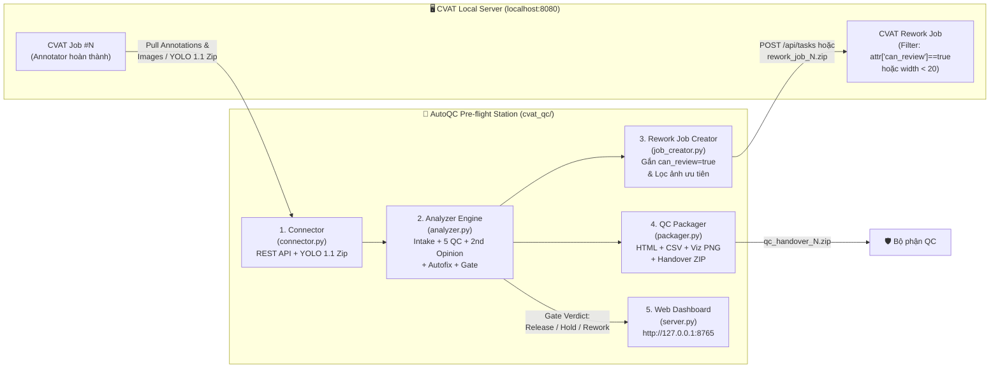

# Bản Kế Hoạch Phát Triển: CVAT Local AutoQC Pre-flight Station (Bonus Core)

**Dự án:** `K5-L23-Day09-LaThaiHoa-2A202603069-AutoQC-Pipeline-Lab`  
**Học viên:** La Thái Hòa (`2A202603069`)  
**Phiên bản:** v1.0 — Tích hợp CVAT Local & Pipeline Day 09  

---

## 1. Bối Cảnh & Mục Tiêu Nghiệp Vụ

Trong quy trình gán nhãn thực tế trên **CVAT Local**, khi một người gán nhãn (Annotator) hoàn thành một **CVAT Job**, bộ phận QC phải mở thủ công từng ảnh để dò lỗi. Các điểm nghẽn chính:
1. **Tốn thời gian cho lỗi quy tắc**: Ảnh hỏng, ảnh trùng, box tràn biên, box diện tích 0, box trùng lặp hoặc box siêu nhỏ (`BOX_TINY`) lẽ ra máy có thể quét tự động tức thì.
2. **Thiếu hàng đợi ưu tiên**: Cần dồn sự chú ý của người kiểm vào ảnh có rủi ro ngữ nghĩa cao (`MISSING`, `WRONG_CLASS`, `LOOSE_BOX`) thay vì duyệt tuần tự.
3. **Thiếu công cụ đóng gói & tạo Rework Job nhanh**: Cần tách riêng ảnh lỗi thành một CVAT Rework Sub-Job (gắn sẵn `can_review=true` để lọc trực tiếp trong CVAT) và xuất hồ sơ bàn giao cho bộ phận QC.

**Giải pháp `CVAT Local AutoQC Pre-flight Station` (`cvat_qc/`):**
Tái sử dụng toàn bộ lõi kiểm tra của Pipeline Day 09 để biến thành **Trạm Kiểm Soát Nhanh** tích hợp trực tiếp với CVAT Local (qua CVAT REST API hoặc gói YOLO 1.1 / CVAT XML 1.1).

---

## 2. Kiến Trúc Tổng Thể



---

## 3. Thành Phần Module (`cvat_qc/` & `scripts/cvat_autoqc.py`)

| Module | Trách nhiệm chính | Đầu vào / Đầu ra |
|---|---|---|
| `cvat_qc/connector.py` | Giao tiếp CVAT Local REST API (`/api/jobs/{id}`, `/api/tasks`) & chuyển đổi chuẩn **YOLO 1.1 Zip** ↔ `Dataset` ↔ **CVAT 1.1 XML** (gắn `can_review=true`). | CVAT Server / Zip / Folder → `Dataset`, `annotations.xml` |
| `cvat_qc/analyzer.py` | Chạy Intake + 5 QC Checks + Second Opinion (`yolo26l`) + Safe Autofix Preview + Gate Verdict + tính Quality Score & danh sách box cần gắn cờ. | `Dataset` + `configs/pipeline.yaml` → `JobQCResult` |
| `cvat_qc/job_creator.py` | Tách các ảnh lỗi/ưu tiên thành **Rework Sub-Job** (`rework_job_<id>.zip` chuẩn YOLO 1.1 + `cvat_annotations_can_review.xml` + `rework_manifest.json`), hỗ trợ đẩy lên CVAT API. | `JobQCResult` → Rework ZIP / CVAT Task URL |
| `cvat_qc/packager.py` | Vẽ ảnh đối chiếu (Box Annotator nét liền vs Box `yolo26l` gợi ý nét đứt), sinh `qc_report.html`, `qc_report.md`, gom CSV và đóng gói `qc_handover_<id>.zip` gửi bộ phận QC. | `JobQCResult` → `qc_handover_<id>.zip` |
| `cvat_qc/server.py` + `scripts/cvat_autoqc.py` | CLI 1 lệnh + Web Dashboard trực quan (`http://127.0.0.1:8765`) xem KPI, ảnh lỗi, lọc nhanh và tải các gói ZIP. | CLI flags / HTTP requests |

---

## 4. Hướng Dẫn Chạy Nhanh

```bash
# Chạy kiểm tra 1 CVAT Job / thư mục ảnh nhãn và xuất toàn bộ báo cáo + Rework Job + QC Handover Bundle
python scripts/cvat_autoqc.py --job-id job_raw_224 --annotator "La Thai Hoa" --src data/raw --out work/cvat_station

# Mở giao diện Web Trạm Kiểm Soát Nhanh trực quan trên trình duyệt
python scripts/cvat_autoqc.py --job-id job_raw_224 --annotator "La Thai Hoa" --src data/raw --out work/cvat_station --serve --port 8765
```
