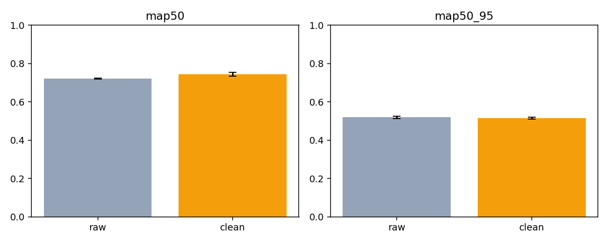
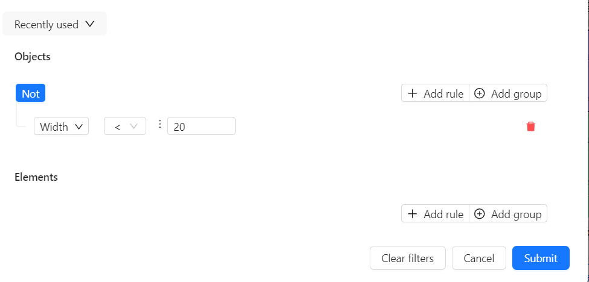
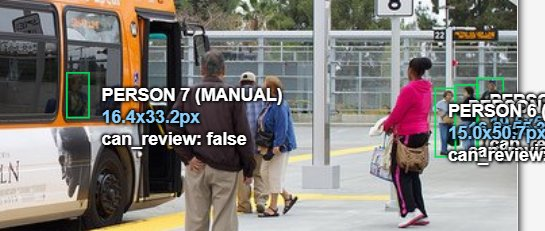
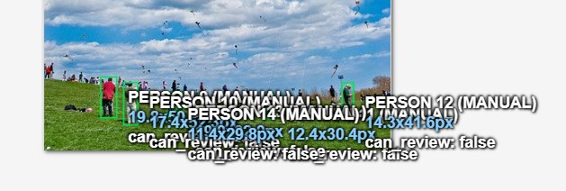
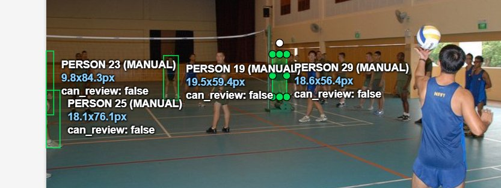

# Báo cáo Day 09 — La Thái Hòa, 2A202603069

## 1. Kết luận trước
Pipeline kết luận **Hold** (mã thoát `10`). Trong **224** ảnh đầu vào từ `data/raw`, bước 1 (intake) nhận **202/224** ảnh sạch về mặt tệp/trùng lặp (loại **22/224** ảnh hỏng, quá nhỏ, trùng hoặc rò rỉ test), xuất bản nháp `submission/export/clean_v1/` gồm **202** ảnh (`n_errors = 0`). Tuy nhiên sau khi người duyệt xử lý hết ngân sách **80/125** ảnh trong hàng đợi, vẫn còn **38/202** ảnh (**18.81%**) mang cảnh báo chưa được duyệt — vượt ngưỡng `warn_ratio_hold = 10%` nên chưa thể phát hành chính thức (**Release**).

## 2. Lỗi và phân việc
Tổng hợp từ `02_error_list_v1.txt` (**224** ảnh quét ở cửa vào, **202** ảnh vào QC nhãn):

| Mã lỗi | Số ảnh / dòng | Ai sửa | Vì sao |
|---|---:|---|---|
| `CORRUPT_IMAGE` | 2 ảnh | Máy (`intake`) | Ảnh cắt cụt/hỏng giải mã khi `load()`, loại khỏi lô. |
| `BAD_SIZE` | 3 ảnh | Máy (`intake`) | Cạnh ngắn < `250px`, không đạt độ phân giải tối thiểu. |
| `DUP_IMAGE_EXACT` | 8 ảnh | Máy (`intake`) | Trùng từng byte theo MD5, giữ bản đầu và loại bản sau. |
| `DUP_IMAGE_NEAR` | 4 ảnh | Máy (`intake`) | Trùng gần đúng (`phash_dist <= 10`), loại bản biến đổi. |
| `LEAK_TEST` | 5 ảnh | Máy (`intake`) | Trùng ảnh trong `data/test` (`test_009`, `033`, `039`, `044`, `085`), loại để tránh rò rỉ đánh giá. |
| `BAD_CLASS_NAME` | 2 dòng (`data.yaml`) | Máy (`autofix`) | Chuẩn hóa `Person`→`person`, `Bus`→`bus` theo `cfg["classes"]`. |
| `BAD_FORMAT` | 3 dòng / 3 ảnh | Máy (`autofix`) | Dòng thiếu cột hoặc chứa `nan` không thể dùng để train → `drop_line`. |
| `BAD_CLASS_ID` | 6 dòng / 6 ảnh | Máy (`autofix`) | ID ngoài `0..3` (`-1`, `4`, `7`, `93`) → `drop_line`. |
| `BOX_ZERO` | 4 dòng / 4 ảnh | Máy (`autofix`) | Chiều rộng hoặc chiều cao bằng `0` → `drop_line`. |
| `BOX_OUT_OF_IMAGE` | 8 dòng / 8 ảnh | Máy (`autofix`) | Mép box vượt `[0, 1]` quá `0.002` → `clip_box` cắt về biên hợp lệ. |
| `DUP_BOX` | 7 dòng / 7 ảnh | Máy (`autofix`) | Hai box cùng lớp có `IoU > 0.9` → `drop_line` dòng sau. |
| `MISSING_LABEL_FILE` | 6 ảnh | Người | Máy không được bịa nhãn; `autofix` ghi `needs_label` đẩy lên đầu hàng đợi. |
| `CLASS_RARE` | 4 lớp lạ (`<dataset>`) | Máy gián tiếp | Phát sinh từ ID lạ `-1, 4, 7, 93`; tự hết ở `v2` sau khi xóa `BAD_CLASS_ID`. |
| `EMPTY_LABEL` | 12 ảnh (v1) → 15 (v2) | Người | Cần mắt người phân biệt ảnh nền thật hay ảnh bị xóa mất nhãn. |
| `BOX_TINY` | 6 dòng (v1) → 7 (v2) | Người | Box < `12px` (tăng thêm 1 ca trên `img_0030` sau khi `clip_box`). |
| `BOX_HUGE` | 3 dòng / 3 ảnh | Người | Box phủ > `95%` diện tích ảnh, cần xác nhận lại ranh giới vật thể. |
| `POSSIBLE_WRONG_CLASS` | 18 cảnh báo | Người | Chỉ model gợi ý, người phải xác minh ngữ nghĩa (`car`/`truck`/`bus`/`person`). |
| `POSSIBLE_MISSING` | 53 cảnh báo | Người | Nghi sót vật thể (`yolo26l` thấy nhưng nhãn thiếu), người kiểm trước khi thêm box. |
| `POSSIBLE_LOOSE_BOX` | 28 cảnh báo | Người | Khớp lỏng (`0.3 <= IoU < 0.5`), người tinh chỉnh tọa độ box. |
| `POSSIBLE_FALSE_POS` | 25 dòng (v1) → 24 (v2) | Người | Box nhãn không khớp dự đoán model (giảm 1 ca ở `img_0108` sau `clip_box`). |

**Giải thích hàng đợi & độ phủ ngân sách 80 ảnh:** `05_review_queue.csv` xếp hạng bằng tổng trọng số `weights` (`NEEDS_LABEL=10`, `POSSIBLE_WRONG_CLASS=3*(1+conf)`, `POSSIBLE_MISSING=2*(1+conf)`, `POSSIBLE_FALSE_POS=2`, `POSSIBLE_LOOSE_BOX=1.5*(1+conf)`...), do đó 6 ảnh thiếu file nhãn (`img_0031, 0053, 0126, 0135, 0170, 0219`) và ảnh nhiều lỗi nghiêm trọng (`img_0020` điểm `11.524`) đứng đầu hàng đợi. Trong **125** ảnh của hàng đợi (chứa **123** cảnh báo ngữ nghĩa trên **103** ảnh), ngân sách **80** ảnh giúp người duyệt xử lý trọn **6/6** ảnh thiếu nhãn và **94/123 (76.4%)** lỗi ngữ nghĩa: **18/18 (100%)** `POSSIBLE_WRONG_CLASS`, **51/53 (96.2%)** `POSSIBLE_MISSING`, **13/24 (54.2%)** `POSSIBLE_FALSE_POS`, và **12/28 (42.9%)** `POSSIBLE_LOOSE_BOX`.

## 3. Calibration (2 ngưỡng)
| Tham số | Khởi đầu | Đã chọn | Precision / Recall (trước → sau) | Lý do (đánh đổi) |
|---|---:|---:|---|---|
| `duplicates.phash_dist` | 2 | **10** | `DUP_EXACT`: `1.00/1.00 → 1.00/1.00` `DUP_NEAR`: `1.00/0.50 → 1.00/0.67` | Giữ Precision = `1.00` (không xóa nhầm ảnh tốt) và nâng Recall trên calib; trên `raw` bắt thêm `img_0186` (trùng `img_0061`, dist=10) mà không tạo dương tính giả. |
| `second_opinion.conf` | 0.25 | **0.6** | `WRONG_CLASS`: `0.56/0.83 → 0.62/0.83` `MISSING`: `0.50/1.00 → 0.57/1.00` `LOOSE_BOX`: `0.29/0.40 → 0.20/0.20` `FALSE_POS`: `0.36/1.00 → 0.36/1.00` | Nâng `conf` từ `0.25 → 0.6` giúp tăng Precision cho `WRONG_CLASS` và `MISSING`, giảm hàng đợi trên `raw` từ `143` xuống `125` ảnh mà **không làm rơi Recall** của `MISSING` (`1.00`) và `WRONG_CLASS` (`0.83`). Không chọn `0.8` (dù ra Release) vì `MISSING` bị tụt Recall xuống `0.75` (bỏ sót lỗi để đạt Release giả). |

**Điểm calibration có thể đánh lừa:** Trên `data/calib` (39 ảnh), bảng sweep gợi ý `phash_dist = 16` đạt F1 cao nhất (`DUP_NEAR`: `1.00 / 0.83 / 0.91`), tưởng như không có FP. Tuy nhiên `calibrate.py` không chấm mã `LEAK_TEST` trong `MANIFEST.csv`: ngay ở `phash_dist = 16`, ảnh `calib_027` (chơi tennis) bị gán nhầm `LEAK_TEST` với `test_027` (đuôi xe tải). Khi chạy trên `data/raw`, `phash_dist = 16` vọt từ 17 lên 26 ảnh bị loại (xóa oan 9 ảnh sạch như `img_0011` tennis bị ghép nhầm với `img_0008` trượt tuyết ở dist=16), còn `phash_dist = 20` loại nhầm tới 134/224 ảnh.

## 4. Cửa chặn và điều pipeline KHÔNG bắt được
- **(a) Chứng minh gate chặn đúng:** Chạy `python -m pipeline.run --budget 0 --reports work/rep_nb --export-dir work/exp_nb`: vì không có người duyệt, **6** ảnh `MISSING_LABEL_FILE` (`img_0031, 0053, 0126, 0135, 0170, 0219`) vẫn còn lỗi `ERROR` tại QC vòng 3. Gate kết luận **REWORK — còn 6 lỗi bắt buộc chưa xử lý**, trả về **mã thoát `20`** và Bước 5 **không xuất** thư mục `work/exp_nb/clean_v1` (`Test-Path` = `False`).
- **(b) ≥ 2 điểm mù của pipeline (có bằng chứng):**
  1. **Vật thể nhỏ (< 600 px²) bị bỏ qua ở `second_opinion`:** Ngưỡng cố định `min_area_px = 600` làm model lớn bỏ qua các xe/người ở xa dù độ tin cậy cao, ví dụ `img_0007` (car conf 0.85, 472.3 px²), `img_0009` (car conf 0.71, 264.3 px²) và `img_0031` (person conf 0.61, 235.5 px²).
  2. **Box lỏng nhẹ (`0.5 <= IoU < 0.65`):** Vì `iou_loose = 0.5`, các box lệch vừa phải nhưng vẫn đạt `IoU >= 0.5` đi qua im lặng (vd. `img_0021` lớp `person` IoU `0.577`; `img_0043` lớp `person` IoU `0.581`).
  3. **Ảnh trùng biến đổi mạnh (cắt khung + thu nhỏ):** Ảnh `calib_038` (cắt hẹp và thu nhỏ từ `calib_024`) có khoảng cách Hamming `phash = 18 > 10`, vượt ngoài ngưỡng an toàn nên không thể bắt bằng pHash nếu không gây hàng loạt dương tính giả.

## 5. Train: raw vs clean (tùy chọn, chấm riêng)
- **Thiết lập công bằng (chạy cục bộ trên NVIDIA GeForce RTX 3060 Laptop GPU):** Cùng model khởi tạo `yolo26n.pt`, cùng siêu tham số (`epochs=20`, `batch=16`, `imgsz=640`, `deterministic=True`), cùng tập `val` (`gold_val`, 40 ảnh) và đo trên cùng tập `test` (100 ảnh) qua **2 seed (`0, 1`)** bằng `scripts/train_compare.py` và tổng hợp bởi `scripts/summarize_results.py` (`submission/results/comparison.md`, `comparison.png`).

| Biến thể | #ảnh train | Số seed | mAP50 (TB ± độ lệch) | mAP50-95 (TB ± độ lệch) | Precision (TB ± độ lệch) | Recall (TB ± độ lệch) |
|---|---:|---:|---|---|---|---|
| `raw` | 224 | 2 | `0.722 ± 0.003` (`0.7202`, `0.7239`) | `0.520 ± 0.006` (`0.5153`, `0.5243`) | `0.748 ± 0.026` | `0.640 ± 0.033` |
| `clean` | 202 | 2 | `0.744 ± 0.010` (`0.7369`, `0.7513`) | `0.515 ± 0.005` (`0.5183`, `0.5117`) | `0.815 ± 0.083` | `0.658 ± 0.044` |
| **Chênh (`clean − raw`)** | **−22** | — | **+0.022** | **−0.005** | **+0.067** | **+0.018** |

- **AP50 từng lớp (TB 2 seed):** `bus`: `0.678 → 0.742` (**+0.064**, giảm hẳn dao động giữa 2 seed từ `0.621 / 0.735` xuống `0.743 / 0.741`); `car`: `0.727 → 0.750` (**+0.023**); `truck`: `0.648 → 0.654` (+0.006); `person`: `0.835 → 0.830` (−0.005). 
- **So sánh chênh lệch với độ nhiễu giữa seed:** Ở `mAP50`, mức tăng `+0.022` vượt tổng độ lệch chuẩn (`0.003 + 0.010 = 0.013`) và cả 2 seed của `clean` đều cao hơn `raw`. Ngược lại, ở `mAP50-95` (`−0.005` so với độ lệch `±0.006 / ±0.005`), `Precision` (`+0.067` nhưng độ lệch `clean` tới `±0.083`) và `Recall` (`+0.018` so với độ lệch `±0.033 / ±0.044`), sự chênh lệch **nằm trong vùng nhiễu giữa các seed**.
- **Nguyên nhân có thể & cách kiểm:**
  1. **Rò rỉ tập test (`LEAK_TEST`) tạo lợi thế ảo cho `raw` ở IoU chặt:** `raw` giữ 5 ảnh trùng `data/test` (`test_009, 033, 039, 044, 085`) nên dễ đạt `mAP50-95` cao hơn nhờ học thuộc biên box trên 5 ảnh đó, trong khi `clean` đã loại sạch. *Cách kiểm:* Đánh giá lại trên 95 ảnh `test` đã loại 5 ảnh bị rò rỉ.
  2. **Box lỏng (`POSSIBLE_LOOSE_BOX`) còn tồn đọng trong `clean_v1` (trạng thái `Hold`):** Với ngân sách 80 ảnh, mới duyệt được `12/28 (42.9%)` ca `POSSIBLE_LOOSE_BOX` và `13/24 (54.2%)` ca `POSSIBLE_FALSE_POS`. Việc sửa trọn `18/18` `POSSIBLE_WRONG_CLASS` và `6/6` `MISSING_LABEL_FILE` giúp `mAP50` tăng (đặc biệt lớp `bus`), nhưng các box lỏng còn lại làm biên dự đoán chưa khít nên `mAP50-95` chưa cải thiện. *Cách kiểm:* Duyệt nốt hàng đợi `POSSIBLE_LOOSE_BOX` (ngân sách ≥ 100–125 ảnh) rồi train lại kiểm tra `mAP50-95`.
  3. **Phương sai lớn do 2 seed và tập test nhỏ (100 ảnh):** Với chỉ 2 seed và 20 epoch, độ lệch Precision đạt `±0.083`. *Cách kiểm:* Chạy mở rộng lên 5 seed (`0..4`) và 40 epoch.
- **Kết luận trung thực & việc tiếp theo:** `clean_v1` (dù ít hơn 22 ảnh và không hưởng lợi từ 5 ảnh rò rỉ test) cho tín hiệu tích cực ở `mAP50` (`+0.022`, nhất là `bus` `+0.064`), nhưng **chưa đủ bằng chứng để khẳng định tốt hơn toàn diện** vì `mAP50-95` chênh `−0.005` và Precision/Recall nằm trong vùng nhiễu giữa 2 seed. Việc tiếp theo là duyệt thêm tối thiểu 18 ảnh (trọng tâm `POSSIBLE_LOOSE_BOX`) để đưa dữ liệu lên **Release**, sau đó chạy kiểm định ≥ 5 seed trên tập test sạch không rò rỉ.

## 6. Quyết định và ghi chú AI
- **(a) Quyết định cuối:** Giữ kết luận **Hold** cho lô `clean_v1` (202 ảnh, 0 lỗi bắt buộc). Để chuyển sang **Release** (`warn_ratio < 10%`), cần tăng ngân sách duyệt từ 80 lên tối thiểu **98** ảnh (duyệt thêm ≥ **18** ảnh đầu phần còn lại của `05_review_queue.csv`: bắt đầu từ `img_0210`, `img_0032` mang `POSSIBLE_MISSING`, `img_0018` mang `BOX_HUGE;POSSIBLE_LOOSE_BOX` và 15 ảnh `POSSIBLE_LOOSE_BOX` tiếp theo) để đưa số ảnh còn cảnh báo chưa duyệt từ `38/202` (`18.81%`) xuống ≤ `20/202` (`9.90%`).
- **(b) Quy trình làm việc (Workflow) & Nhật ký trao đổi AI (`docs/PROMPTING.md`):**
  - **Mô hình phối hợp — Phân tách rõ 2 phạm vi:**
    - *Phần lõi bài Lab Day 09 (4 module, Calibration, Gate, CVAT thủ công, Train so sánh):* **Học viên chủ đạo thực hiện & quyết định** (đọc đề, chạy kiểm thử, soi ảnh dữ liệu thật, thao tác lọc trên CVAT, đặt câu hỏi phản biện và chốt kết luận); AI (**Google Antigravity** — **Orchestrator (Argon)** / **Gemini 4 Neon**) chỉ đóng vai trò **cố vấn, gợi ý và hướng dẫn**.
    - *Phần mở rộng Bonus Core (`CVAT Local AutoQC Pre-flight Station`):* Áp dụng **Vibe Coding chủ động** (`/plan` + `/agent-dev-team` + `/goal`, chi tiết đầy đủ tại [docs/CVAT_AUTOQC_DEMO_REPORT.md](../docs/CVAT_AUTOQC_DEMO_REPORT.md) mục 7) để xây dựng nhanh nguyên mẫu tích hợp thực tế vào CVAT Local và kiểm chứng bằng bộ test tự động + Chrome DevTools.
  - **Workflow 5 bước thực hiện bài Lab (Người thực hiện ↔ AI gợi ý):**

| Pha thực hiện | Vai trò chủ đạo của học viên (Tự thực hiện & quyết định) | Vai trò hỗ trợ của AI (Chỉ gợi ý & hướng dẫn) |
|---|---|---|
| **1. Đọc đề & 4 module lõi** | Tự rà soát `RULES.md`, `GUIDE.md`, đọc từng hàm & kiểm tra không hardcode ngưỡng, không `except: pass`, không sửa `data/raw`; chạy `pytest` xác minh `79/79` test gốc. | Giải thích đặc tả docstring/test case, gợi ý khung thuật toán cho `label_format`, `second_opinion`, `autofix`, `gate` theo chuẩn `cfg`. |
| **2. Calibration 2 ngưỡng** | Chạy `pipeline.calibrate`, đọc bảng sweep trong `calibration_report.md`, **tự mở ảnh gốc** (`img_0061`/`0186`, `img_0008`/`0011`) đối chiếu bằng mắt và tự quyết định chọn `phash_dist = 10`, `conf = 0.6`. | Giải thích ý nghĩa đánh đổi Precision/Recall và hướng dẫn cách kiểm tra cặp ảnh dương tính giả trên `data/raw`. |
| **3. Pipeline, Gate & CVAT thủ công** | Chạy `pipeline.run` (`Hold`), thử nghiệm `--budget 0` (`Rework`, mã thoát `20`), đối chiếu `07_error_list_v3.txt`; **tự mở CVAT Local (`Job #36`), thiết lập bộ lọc `Width < 20`, duyệt từng frame và chụp 4 ảnh bằng chứng** đối chiếu với `BOX_TINY`. | Hướng dẫn thứ tự kiểm tra 8 file báo cáo, chuẩn bị tập 20 ảnh đúng chuẩn `docs/CVAT_FILTER.md` và giải thích cách dùng bộ lọc CVAT. |
| **4. Train cục bộ (`raw` vs `clean`)** | Đề xuất chạy train trên GPU cục bộ (**RTX 3060**) để lấy trọn 15 điểm, kiểm tra `comparison.md`, **tự đặt câu hỏi phản biện về việc chênh lệch giữa `raw` và `clean` không lớn**, rà soát nguyên nhân và chốt kết luận trung thực. | Kiểm tra môi trường CUDA/Ultralytics, hướng dẫn chạy `train_compare.py`, giải thích các nguyên nhân kỹ thuật (`LEAK_TEST`, pretrained COCO, `POSSIBLE_LOOSE_BOX`) và chẩn đoán lỗi `CRLF/LF` trên Windows. |
| **5. Mở rộng Bonus Core & Kiểm định** | Đưa ra yêu cầu nghiệp vụ từ giảng viên (tách Rework theo loại Issue, ghi lịch sử chỉnh sửa, đồng bộ giao diện CVAT Light Theme), tự nghiệm thu trên trình duyệt và chốt `python scripts/check_submission.py` (`0 lỗi, 0 cảnh báo`). | Gợi ý kiến trúc tích hợp CVAT REST API v2 (`cvat_qc/`), hướng dẫn khắc phục lỗi CORS/COEP & viết test bổ sung (`tests/test_cvat_qc.py`). |

  - **Bảng ghi Log Chat AI (AI Interaction Log — Đầy đủ theo trình tự làm bài):**

| # | Thời điểm & Mô hình | Câu hỏi / Yêu cầu thực tế tôi gửi AI (Prompt) | Gợi ý & hướng dẫn từ AI | Việc tôi tự thực hiện & kiểm chứng | Điểm AI nhầm / tôi tự hiệu chỉnh |
|---:|---|---|---|---|---|
| **1** | 18/11 · `Orchestrator (Argon)` | *"Phân tích tạo báo cáo hướng dẫn thực hiện lab cho tôi, `/plan` `/agent-dev-team` `/goal`"* (kèm đặc tả docstring 4 module & `RULES.md`). | Lập lộ trình TDD (`label_format` → `second_opinion` → `autofix` → `gate`), gợi ý khung đọc ngưỡng động từ `configs/pipeline.yaml` và quy trình chạy `calibrate` + `pipeline.run`. | Đọc rà từng hàm kiểm tra quy tắc an toàn (`RULES.md`), chạy `pytest` (`79/79` xanh), chạy `pipeline.run --budget 0` xác minh Gate trả `Rework` (mã `20`) và mở ảnh gốc kiểm tra `calibration_report.md`. | Sweep trên `calib` gợi ý F1 cao nhất ở `phash_dist = 16`, nhưng tôi soi ảnh thật trên `raw` thấy xóa nhầm 9 ảnh sạch (`img_0008` trượt tuyết vs `img_0011` tennis) → **tự siết về `phash_dist = 10`**. |
| **2** | 18/11 · `Orchestrator (Argon)` *(Vibe Coding — Bonus Core)* | *"Thầy có thông báo 1 bonus core... thiết kế 1 chức năng tích hợp cho CVAT local tự động check lỗi của 1 job... tạo job mới để sửa lỗi, đóng gói gửi bộ phận QC... `/plan` `/agent-dev-team` `/goal`"* → *"Tích hợp thêm ghi lại lịch sử chỉnh sửa rework, tạo task mới theo từng loại issue... Chỉnh giao diện giống giao diện mặc định của CVAT."* | Vibe code trọn gói kiến trúc `cvat_qc/`, tích hợp CVAT REST API v2, cài plugin `cvat_ui`, bổ sung `rework_history.py`, tách Task theo `issue_codes`, đồng bộ Ant Design Light Theme và sinh báo cáo demo. | Tự nghiệm thu trực tiếp trên `http://localhost:8080` và `http://127.0.0.1:8765`, kiểm tra bảng thuộc tính từng chức năng và chạy tổng kiểm thử `pytest` (`84 passed`). | Khắc phục các lỗi thực tế khi nối CVAT Local: header `Accept: application/vnd.cvat+json` (`406`), tách `project_id`/`labels` (`400`), quyền `nginx-unprivileged`, header `CORP` vượt `COEP`. |
| **3** | 19/11 · `Gemini 4 Neon` | *"Do thầy yêu cầu cần tự làm và đối chiếu thủ công. Nên bạn hãy chuẩn bị sẵn môi trường, job và chỉ ra các hành động cần làm... Không ý tôi là chỉ riêng phần bài Lab hôm nay chứ không phải phần Auto QC."* → *"Làm vậy sao?"* (gửi ảnh bộ lọc CVAT `Width < 20`). | Tạo riêng Job `#36` (`day09-lab-manual-review-20`, 20 ảnh dùng `cvat/labels.json`), liệt kê checklist đối chiếu `docs/CVAT_FILTER.md` và hướng dẫn kiểm tra bộ lọc. | **Tự thao tác trên CVAT (`localhost:8080/tasks/42/jobs/36`)**, đặt bộ lọc `Width < 20`, duyệt từng frame `img_0020`, `img_0026`, `img_0030`, chụp 4 ảnh bằng chứng (`submission/cvat_evidence/`) và đối chiếu từng kích thước box (`11.4×29.8 px`, `9.8×84.3 px`) với `BOX_TINY < 12 px`. | AI nhầm tưởng nút `Not` màu xanh trong query builder CVAT đang bật phủ định; sau khi tôi tự bấm `Submit` và đối chiếu ảnh thực tế, tôi xác nhận bộ lọc hoạt động đúng chiều `< 20 px`. |
| **4** | 19/11 · `Gemini 4 Neon` | *"Theo như thầy nói thì có thể train tại máy local cũng được bạn hãy thiết kế để có thể train tại máy local và lấy trọn vẹn điểm phần này."* | Kiểm tra GPU cục bộ (**RTX 3060**, CUDA 12.1), hướng dẫn nâng cấp `ultralytics 8.4.215` để tải `yolo26n.pt` và chạy `scripts/train_compare.py` + `summarize_results.py`. | Theo dõi 4 lần chạy (`raw`/`clean` × 2 seed × 20 epoch), đối chiếu `comparison.md` với 4 file `*_seed*.json` và kiểm tra bằng `python scripts/check_submission.py`. | `check_submission.py` báo lệch `manifest_sha1` do Windows ghi `manifest.json` bằng `CRLF` trong khi máy chấm băm theo `LF` → kiên quyết **không sửa tay `clean_seed*.json`**, chuẩn hóa `manifest.json` sang `LF` và chạy lại `train_compare.py` cho `clean` đến khi đạt **`0 lỗi, 0 cảnh báo`**. |
| **5** | 19/11 · `Gemini 4 Neon` | *"Sao tôi thấy giữa raw và clean không có quá nhiều chênh lệch nhỉ?"* → *"Điều đó là lỗi từ lab hay từ lỗi của mình?"* | Phân tích 4 nguyên nhân kỹ thuật dựa trên số liệu thực (`LEAK_TEST`, pretrained COCO, `Hold` còn 16 ca `POSSIBLE_LOOSE_BOX`, lớp `bus` tăng `+0.064`) và dẫn chứng `docs/COLAB.md` / `RUBRIC.md`. | Đối chiếu lại `07_error_list_v3.txt`, `comparison.json` và tự chốt kết luận trung thực ở Mục 5 (không thổi phồng `clean` thắng toàn diện khi `mAP50-95` và P/R nằm trong vùng nhiễu). | — |

  - **Kết quả kiểm định cuối cùng:** `python -m pytest -q` đạt **`84 passed`**, `python scripts/check_submission.py` (bản đầy đủ gồm cả phần Train 15 điểm) đạt **`0 lỗi, 0 cảnh báo`**.
- **Đối chiếu thủ công trên CVAT (`docs/CVAT_FILTER.md`, thưởng +2):**
  - Đã tạo Project trên CVAT Local dùng đúng `cvat/labels.json` (`car, person, truck, bus` + thuộc tính checkbox `can_review`) và kiểm tra thủ công bộ lọc **`Width < 20`** trên Task 20 ảnh (`day09-lab-manual-review-20`, gồm top ảnh `05_review_queue.csv` và toàn bộ 5 ảnh có `BOX_TINY`).
  - **Kết quả đối chiếu CVAT (`width < 20 px`) vs Pipeline (`BOX_TINY < 12 px`):**

| Ảnh đối chiếu trên CVAT | Số box khớp `width < 20` trên CVAT | Khớp `BOX_TINY` (< 12px) của pipeline | Nhận xét sau khi soi bằng mắt |
|---|---:|---:|---|
| `img_0020.jpg` | **4** box `person` (`15.0`, `16.4`, `16.8`, `19.5 px`) | `0` box | Người ngồi trong xe buýt (`16.4×33.2 px`) và người đứng xa đều là đối tượng hợp lệ → ngưỡng `20 px` của CVAT rộng hơn nên bắt dư so với `12 px`. |
| `img_0026.jpg` | **6** box `person` (`11.4`–`19.9 px`) | **1** box (`11.4×29.8 px`) | Trùng đúng ảnh & box `11.4 px` mà pipeline báo `BOX_TINY`; 5 box còn lại (`12.4–19.9 px`) vẫn là người thả diều rõ ràng. |
| `img_0030.jpg` | **4** box `person` (`9.8`, `18.1`, `18.6`, `19.5 px`) | **1** box (`9.8×84.3 px`) | Trùng đúng box `PERSON 23 (9.8×84.3 px)` bị cắt sát mép trái sân bóng chuyền sau khi `clip_box`; 3 box còn lại (`18.1–19.5 px`) là vận động viên hợp lệ. |
| `img_0051`, `img_0069`, `img_0161` | **8** box `person` (`8.9`–`18.8 px`) | **5** box (`8.9`, `11.2`, `10.3`, `11.4`, `11.9 px`) | Toàn bộ 5 box `< 12 px` còn lại của pipeline đều xuất hiện trong kết quả lọc `width < 20` của CVAT. |

  - **Về thuộc tính `can_review`:** Người gán nhãn đánh dấu `can_review = true` trên CVAT khi gặp ca phân vân/khó nhận diện (như box quá nhỏ ở xa, bị che khuất hoặc nghi nhầm lớp `truck`/`bus`) để reviewer lọc nhanh bằng `attr["can_review"] == true`; trong pipeline tự động, cơ chế tương đương chính là việc đẩy các cảnh báo `WARN` (`BOX_TINY`, `POSSIBLE_WRONG_CLASS`, `POSSIBLE_MISSING`...) vào hàng đợi ưu tiên `05_review_queue.csv`.
  - **Ảnh chụp bằng chứng thao tác bộ lọc CVAT:**
    - Bộ lọc `Width < 20`: 
    - `img_0020.jpg` (4 box `15.0–19.5 px` hợp lệ): 
    - `img_0026.jpg` (khớp `11.4×29.8 px` `BOX_TINY`): 
    - `img_0030.jpg` (khớp `PERSON 23: 9.8×84.3 px` `BOX_TINY` sát mép trái): 
- **Ghi chú phần CVAT & Bonus Core (`CVAT Local AutoQC Pre-flight Station`):** Đã thiết kế và hiện thực hóa Trạm Kiểm Soát Nhanh tích hợp CVAT Local tại [docs/CVAT_AUTOQC_PLAN.md](../docs/CVAT_AUTOQC_PLAN.md) và [docs/CVAT_AUTOQC_DEMO_REPORT.md](../docs/CVAT_AUTOQC_DEMO_REPORT.md), gói `cvat_qc/` và CLI `scripts/cvat_autoqc.py`: tự động quét 1 CVAT Job (`Quality Score: 42.2/100` trên `raw`, `61.7/100` trên Job `#30`), xuất báo cáo HTML/Markdown/ảnh đối chiếu theo giao diện CVAT Light Theme, tạo Rework Task tách theo từng loại Issue (`can_review=true`), ghi nhận lịch sử chỉnh sửa Rework (`rework_history.csv/.json`) và đóng gói `qc_handover_*.zip` cho bộ phận QC.
